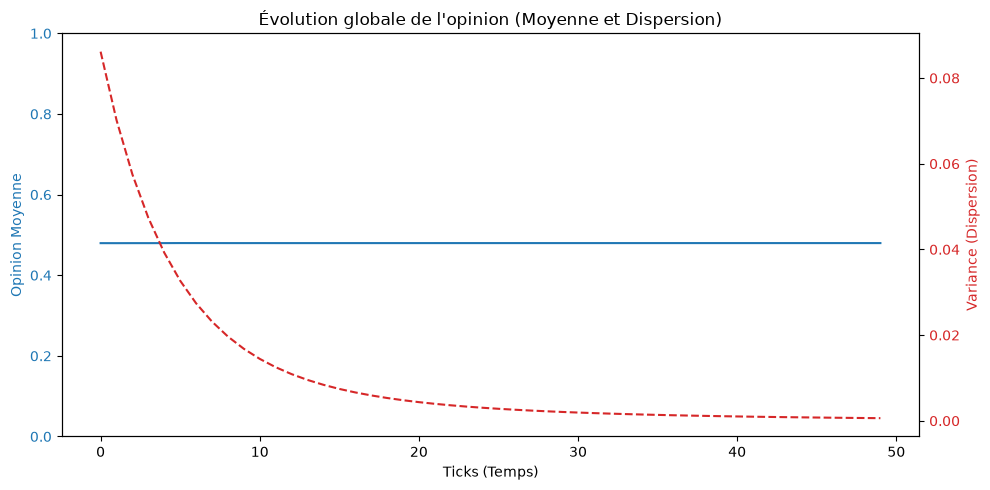
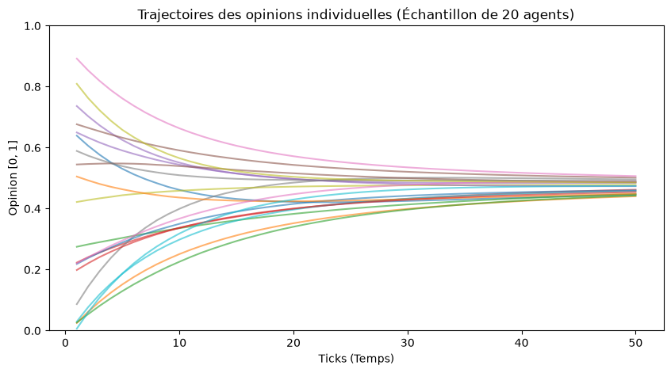
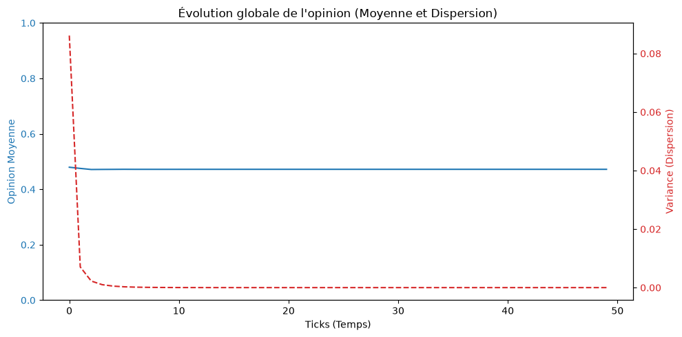
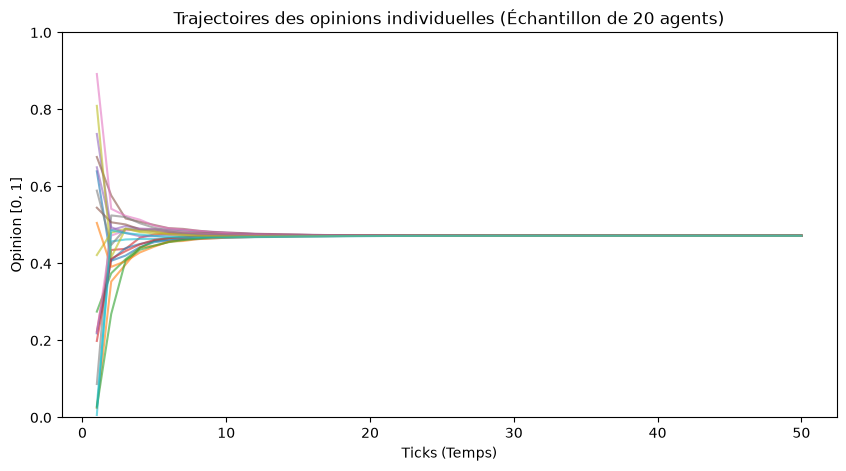
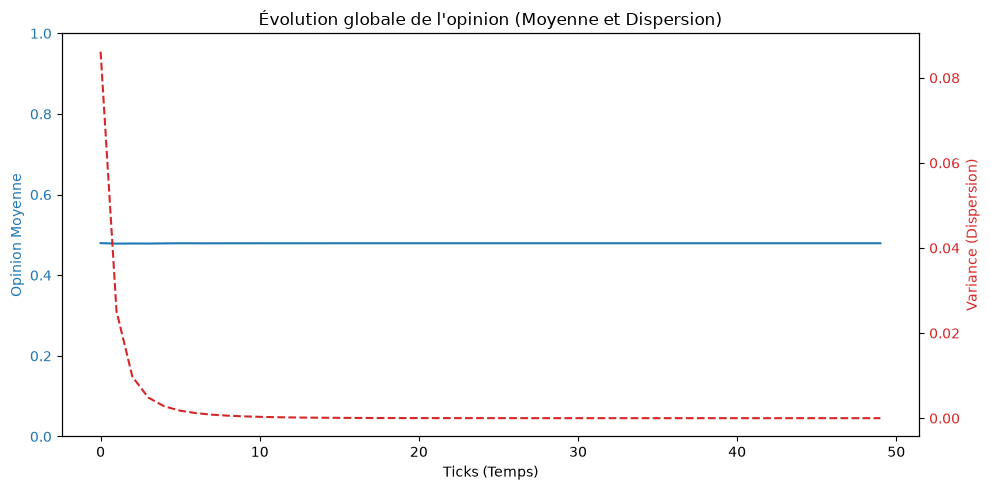
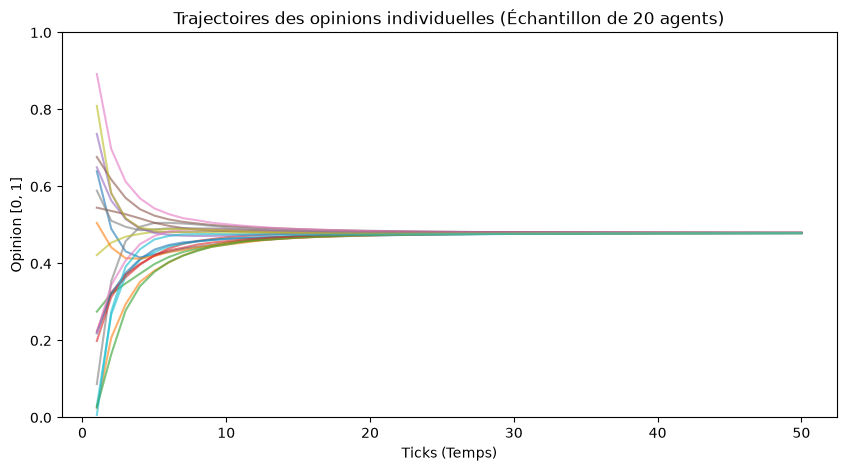

## 5. Partie de compréhension théorique

### 1. Impact de $\alpha$

Le modèle est mis à jour comme ceci :

$$
o_i^{t+1}=o_i^t+\alpha\left(\bar{o}_{N_i}^{t}-o_i^t\right)
$$

#### Lorsque $\alpha$ est petit (tend vers 0)

| Moyenne et dispersion | Trajectoires des opinions |
|---|---|
|  |  |

Lorsque $\alpha$ est petit, l’agent change peu son opinion à chaque étape. La convergence vers une opinion commune est donc **lente**, car l’agent s’adapte progressivement à la moyenne des opinions de ses voisins.

#### Lorsque $\alpha$ tend vers 1

| Moyenne et dispersion | Trajectoires des opinions |
|---|---|
|  |  |

On a :

$$
o_i^{t+1}=o_i^t+\alpha\left(\bar{o}_{N_i}^{t}-o_i^t\right)
$$

Si $\alpha=1$, alors :

$$
o_i^{t+1}
=
o_i^t+1\left(\bar{o}_{N_i}^{t}-o_i^t\right)
$$

Donc :

$$
o_i^{t+1}
=
\bar{o}_{N_i}^{t}
$$

Ainsi, lorsque $\alpha=1$, l’agent **adapte directement son opinion à la moyenne des opinions de ses voisins**. La convergence est alors beaucoup plus rapide que lorsque $\alpha$ est faible.

#### Lorsque $\alpha=0.5$

| Moyenne et dispersion | Trajectoires des opinions |
|---|---|
|  |  |

Lorsque $\alpha=0.5$, l’agent adopte **50 % de l’écart** entre son opinion actuelle et la moyenne des opinions de ses voisins. La mise à jour s’effectue donc progressivement : l’agent ne conserve pas totalement son opinion initiale, mais il ne s’adapte pas non plus directement à la moyenne de ses voisins. La convergence est ainsi **plus rapide que pour une petite valeur de $\alpha$**, mais **plus lente que lorsque $\alpha$ est proche de 1**. Ce cas représente donc un compromis entre la stabilité de l’opinion individuelle et l’adaptation aux opinions des voisins.

## 2. Pourquoi la polarisation devient impossible à long terme

On a :

$$
o_i^{t+1}=o_i^t+\alpha\left(\bar{o}_{N_i}^{t}-o_i^t\right)
$$

On peut développer cette formule pour $\alpha$ compris entre 0 et 1.

$$
o_i^{t+1}
=
(1-\alpha)o_i^t+\alpha\bar{o}_{N_i}^{t}
$$
La nouvelle opinion est alors formée d’une **combinaison de l’opinion actuelle de l’agent et de la moyenne des opinions de ses voisins**. L’opinion de l’agent converge progressivement vers la moyenne de ses voisins.

De plus, d’après cette formule, il n’existe **aucun mécanisme permettant à l’agent de s’éloigner de ses voisins**. Il n’y a pas, par exemple, de seuil de tolérance qui empêcherait l’interaction avec certaines opinions, ni de mécanisme permettant à l’agent de renforcer sa propre opinion. Ainsi, les opinions ont tendance à se rapprocher progressivement les unes des autres, ce qui rend la **polarisation durable difficile, voire impossible, à long terme dans ce modèle**.

## 3. Comment l'émergence apparaît-elle dans les graphiques ?

L’émergence se manifeste par le fait qu’un **comportement collectif apparaît à partir des interactions locales entre les agents**.

Tout ceci se manifeste dans les graphiques. Au début, les agents ont des opinions différentes, car elles sont initialisées aléatoirement. Ensuite, dans la simulation, chacun commence à modifier son opinion au cours du temps.

Comme le montrent les graphiques précédents, la dispersion diminue, ce qui montre que les différences entre les opinions deviennent de plus en plus faibles. Alors, un **consensus global** apparaît progressivement.

Ce qui représente l’émergence est que le consensus **n’apparaît pas directement au début**, et qu’aucun agent ne décide pour tout le monde. Il apparaît progressivement à partir des interactions entre les différents agents.

### 4. Comment fonctionne `self.agents.shuffle_do("step")` ?

Dans une simulation multi-agents, si on utilise une boucle sur tous les agents pour exécuter leur action, les agents peuvent conserver le **même ordre d’exécution** à chaque étape. Par conséquent, l’influence entre les agents peut toujours respecter le même arrangement.

Avec `self.agents.shuffle_do("step")`, l’ordre d’exécution des agents est **mélangé aléatoirement à chaque étape**. Ainsi, les agents n’agissent pas toujours dans le même ordre, ce qui permet d’éviter qu’un ordre fixe influence systématiquement le comportement de la simulation.

### 5. La différence entre `model_reporters` et `agent_reporters`

`model_reporters` permettent de collecter des **indicateurs globaux du modèle**, comme l’opinion moyenne et la variance.

`agent_reporters` permettent de suivre les **variables individuelles de chaque agent**, comme son opinion.

Les deux sont complémentaires : les indicateurs du modèle permettent d’observer la **convergence globale** et la **dispersion**, tandis que les indicateurs des agents permettent de comprendre **l’évolution individuelle des opinions**.

### 6. Quel est l'effet de `torus=True` ?

Avec `torus=True`, les **bords de la grille sont connectés**. Ainsi, un agent situé à `x=0` peut avoir comme voisin un agent situé à l’autre extrémité de la grille.

Cela évite un traitement particulier des frontières et permet d’avoir un **espace sans bord réel**, comme si la grille était enroulée sur elle-même.

### 7. Comment introduire un biais de confirmation avec $\varepsilon$ ?

Pour introduire un biais de confirmation, on peut ajouter un **seuil de tolérance $\varepsilon$**. Un agent ne prend en compte que les voisins dont l’opinion vérifie :

$$
|\text{opinion}_{voisin}-\text{opinion}_{agent}| < \varepsilon
$$

comme ceci :

```python
neighbors = self.model.grid.get_neighbors(
    self.pos,
    moore=True,
    include_center=False
)

compatible_neighbors = [
    neighbor
    for neighbor in neighbors
    if abs(neighbor.opinion - self.opinion) < self.epsilon
]
```

On calcule ensuite la **moyenne uniquement sur compatible_neighbors**. Les opinions trop éloignées sont donc ignorées.

Cette modification peut empêcher l’apparition d’un **consensus global** et favoriser l’apparition de groupes ou de **clusters d’opinion**, voire une polarisation de la population.

### 8. Si on veut modéliser un véritable réseau social ?

Pour représenter un véritable réseau social, une **structure en graphe** serait plus appropriée qu’une grille spatiale. Les utilisateurs seraient représentés par des **nœuds** et leurs relations par des **arêtes**.

Un influenceur pourrait ainsi être représenté par un nœud possédant un **grand nombre de connexions**, tandis qu’un utilisateur isolé aurait peu de connexions.

La **topologie du réseau** déterminerait alors les possibilités d’influence entre les agents.